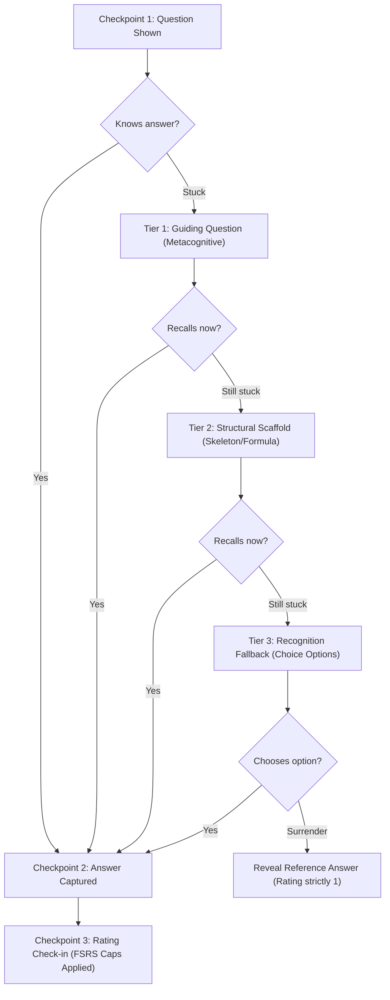

# Socratic Scaffolded Hints in Recall: Preserving Retrieval Before the Reveal

**Status:** Proposed\
**Date:** 2026-10-21\
**Deciders:** Thomas (project owner)\
**Implementation plan:** [2026-10-21-socratic-scaffolded-hints.md](../plans/2026-10-21-socratic-scaffolded-hints.md) (open)\
**Related:**
[2026-07-06b](2026-07-06b-checkpointed-review-dialogue.md) (Checkpointed Review Dialogue: Question → Answer → Rating) ·
[2026-06-27](2026-06-27-recall-session-llm-pipeline.md) (Prompt Cache & Prefetch) ·
[2026-09-08](2026-09-08-answer-points-and-score-based-rating.md) (Answer Points and Score-Based Rating) ·
[2026-09-27](2026-09-27-choice-and-auto-learning-modes.md) (Choice and Auto Learning Modes, Tap Ceiling) ·
[2026-10-08b](2026-10-08b-corporate-deployment-baseline.md) (Agents and Shared Content Are Untrusted) ·
[2026-10-14b](2026-10-14b-card-formulas-images-and-spoken-text.md) (Card Formulas, Images and Spoken Text) ·
[2026-10-19](2026-10-19-zam-academy-cells.md) (ZAM Academy: Two Phases of Learning)

---

## Context

In his keynote address at the Frankfurt Book Fair (*„How AI is changing the way we learn forever“*, YouTube `7lHT_dLtAcw`), mathematics educator Daniel Jung highlighted a central paradox of AI in modern education: **The Answer Trap**. When learners face difficulty, modern generative models can produce complete, polished solutions instantly. However, directly receiving the final answer circumvents the necessary cognitive struggle (*desirable difficulty*, Bjork 1994). The learner experiences an immediate, deceptive feeling of comprehension (*illusion of competence*), but because no active retrieval occurred, retention remains near zero.

### The Problem in Current ZAM Reviews

ZAM’s review loop is defined as a checkpointed sequence ([ADR 2026-07-06b](2026-07-06b-checkpointed-review-dialogue.md)):
1. **Checkpoint 1:** Question shown.
2. **Checkpoint 2:** Answer captured (typed, chosen, or spoken).
3. **Checkpoint 3:** Rating checked in (FSRS state transaction).

Between Checkpoint 1 and Checkpoint 2, a learner who draws a blank currently faces a harsh binary choice:
1. **Stare and give up:** Click „Aufdecken“ (Reveal) without an answer, leading to a rating of `1` (Again).
2. **Guess blindly:** Enter an unfounded attempt to bypass the gate.

When a learner clicks „Aufdecken“, the reference answer is exposed in full. Exactly as Jung observes, the learner reads the answer, thinks *„Ah, of course, I knew that!“*, and clicks `1` or `2`. The chance for self-directed neural retrieval on that concept is destroyed for that session.

ADR 2026-07-06b deliberately prohibited freeform conversational dialogue *before* the answer in the standalone App:
> *„There is deliberately no pre-answer dialogue in the App, so 'help before answering' cannot happen there and the assisted-rating cap sketched in the original proposal is dropped entirely...“*

That decision was sound for unconstrained chat: an open chat prompt easily leaks the exact answer or allows the learner to prompt-engineer the evaluator. However, it created a didactic vacuum between complete recall and complete surrender.

Cognitive psychology and educational scaffolding (Wood, Bruner & Ross 1976; Karpicke & Roediger 2008) show that **cued retrieval** (providing minimal structural cues) triggers active memory reconstruction far better than immediate full reveals, provided the assistance is strictly graduated and recorded.

---

## Decisions

### 1. Bounded Scaffolding Between Checkpoint 1 and Checkpoint 2

We introduce **Socratic Scaffolded Hints** strictly bounded between Checkpoint 1 (Question shown) and Checkpoint 2 (Answer captured). 

Unlike an unconstrained chat, hints are **discrete, progressive, one-way structural prompts** requested via a dedicated action button (`Tipp?` / `Need a hint?` or `Cmd+H` / `Ctrl+H`).
* Hints do **not** open a freeform chat input before the answer.
* Hints never reveal the definitive terminology or numerical solution.
* Every hint requested is tracked and imposes a deterministic ceiling on the FSRS rating.

### 2. The Three-Tier Hint Hierarchy

Scaffolding advances through at most three discrete tiers:



#### Tier 1: Orienting / Metacognitive Prompt (*Leitfrage*)
* **Purpose:** Directs attention to the underlying principle without providing facts.
* **Example:**
  * *Question:* „Wie verhält sich die Energie $W_{\text{el}}$ eines Kondensators bei Verdoppelung des Plattenabstands $d$ ($Q = \text{konstant}$)?“
  * *Tier 1 Hint:* „Überlege zuerst: Welcher Zusammenhang besteht zwischen dem Plattenabstand $d$ und der Kapazität $C$? Und welche Formel für $W_{\text{el}}$ enthält die Konstante $Q$?“[ADR 2026-10-14b](2026-10-14b-card-formulas-images-and-spoken-text.md)

#### Tier 2: Structural Scaffold / Partial Step (*Strukturgerüst*)
* **Purpose:** Provides the mathematical formula template, the first derivation step, or conceptual categories, requiring the learner to perform the actual cognitive synthesis.
* **Example:**
  * *Tier 2 Hint:* „$C = \varepsilon \frac{A}{d} \implies d \cdot 2 \implies C$ halbiert sich. Nutze nun $W_{\text{el}} = \frac{1}{2} \frac{Q^2}{C}$. Was passiert mit dem Bruch, wenn der Nenner halbiert wird?“

#### Tier 3: Recognition Fallback (*Choice Options*)
* **Purpose:** When generative retrieval fails completely, step down from free recall to recognition (Multiple Choice / Fast Check), preserving at least discriminative retrieval ([ADR 2026-09-27](2026-09-27-choice-and-auto-learning-modes.md)).
* **Mechanism:** Displays 3–4 plausible options derived from the token's pre-authored `fast_check` or distractor pool.

---

### 3. FSRS Rating Invariants & Caps

To preserve the absolute mathematical integrity of the FSRS scheduler, receiving assistance must downgrade the maximum achievable rating:

| Highest Hint Tier Used | Permitted FSRS Ratings | FSRS Scheduling Impact |
| :--- | :--- | :--- |
| **None (Tier 0)** | `1` (Again), `2` (Hard), `3` (Good), `4` (Easy) | Standard FSRS scheduling |
| **Tier 1 (Leitfrage)** | `1` (Again), `2` (Hard), `3` (Good) | `4` (Easy) is prohibited. |
| **Tier 2 (Strukturgerüst)** | `1` (Again), `2` (Hard) | Strictly capped at `2` (Hard). Rating `3` and `4` are disabled in UI. |
| **Tier 3 (Recognition)** | `1` (Again), `2` (Hard), `3` (Good) | **Tap Ceiling applies** ([ADR 2026-09-27](2026-09-27-choice-and-auto-learning-modes.md)): Maximum interval capped at 20 days; difficulty cannot be lowered; `answer_format = 'options'`. |
| **Reveal without answer** | `1` (Again) | Standard failed recall transaction. |

*Note on Score-Based Ratings ([ADR 2026-09-08](2026-09-08-answer-points-and-score-based-rating.md)):* When evaluated by points, invoking Tier 1 deducts 10% of total score; Tier 2 deducts 35%; Tier 3 deducts 60%.

---

### 4. Grounded Hint Generation (Source-Bound Prompts)

Hints must never hallucinate external information or contradict the curriculum.

1. **Pre-authored hints:** If a token carries an explicit `hints: string[]` field in its metadata or content JSON, those pre-authored strings take precedence.
2. **On-Demand LLM Generation:**
   * Generated via the existing `recall` role LLM (`src/cli/llm/`).
   * The bridge prompt receives:
     * Card question
     * Card concept & title
     * Token `source_link` / context ([ADR 2026-07-17](2026-07-17-okf-knowledge-base.md), [ADR 2026-10-10](2026-10-10-learning-content-sources.md))
     * Target hint tier (`1` or `2`)
   * **System Prompt Constraint:**
     > *„You are a Socratic tutor. Provide a single, concise hint for Tier {tier}. Never state the final answer, key technical solutions, or numerical results. Ask a guiding question or supply the structural formula framework only. Help the learner deduce the answer themselves.“*
   * Formatted as valid card text segments (`text` and `math` with LaTeX allowlist, conforming to [ADR 2026-10-14b](2026-10-14b-card-formulas-images-and-spoken-text.md)).

---

### 5. Socratic Dialogue in the ZAM Agent Skill (Active Problem Solving)

The Socratic principle applies not only to isolated recall cards in the Studio/Mobile app, but equally to interactive pair-work within the **ZAM agent skill** (`.agent/skills/zam/SKILL.md`):

1. **No pre-baked step-by-step instructions:** When a learner works actively on a task, programming challenge, or mathematical derivation, the agent must **never** deliver a complete, unprompted step-by-step recipe or write the solution on behalf of the user. 
2. **Steps originate from the learner:** The formulation of hypotheses, derivation steps, and procedural actions must remain with the learner.
3. **Socratic guidance on impasse:** When the learner indicates uncertainty or requests help, the agent must respond with a Socratic dialogue rather than a solution:
   * Ask targeted orienting questions (*„Welche Größe fehlt dir noch, um Formel X anwenden zu können?“*).
   * Encourage the learner to deduce the next sub-step themselves.
   * Provide bounded hints (analogous to Tier 1 and Tier 2 scaffolding) only if the learner remains stuck after prompting.
4. **Closing gaps dynamically:** If the Socratic exchange reveals a missing foundational prerequisite, the agent suggests linking or pulling forward that foundation (`zam_suggest_foundations` / `zam_pull_forward_execute`), preserving cognitive continuity.

---

### 6. Schema Migration M049: `hints_used` in `review_logs`

To ensure transparency for analytics and future FSRS parameter fitting, we track hint usage in the immutable audit trail.

1. **Schema update:**
   Add `hints_used INTEGER NOT NULL DEFAULT 0` to `review_logs`.
2. **Numbered migration M049** in `src/kernel/db/provision.ts`:
   ```sql
   ALTER TABLE review_logs ADD COLUMN hints_used INTEGER NOT NULL DEFAULT 0;
   ```
3. Bump `CURRENT_SCHEMA_VERSION` from `48` to `49`.

---

### 7. User Interface & Experience (Studio and Mobile)

1. **Subtle trigger:** Beside the answer input field and the „Aufdecken“ button, a distinct `Tipp anfordern` / `Need a hint?` button appears.
2. **Transparent cost disclosure:** The button shows the rating cap consequence before clicking:
   * 1st click: *„Tipp 1 anzeigen (Max. 'Gut')“*
   * 2nd click: *„Tipp 2 anzeigen (Max. 'Schwer')“*
   * 3rd click: *„Multiple-Choice-Optionen anzeigen (Max. 20 Tage)“*
3. **No distraction:** Unfolded hints are rendered cleanly in an accordion container directly above the answer box.

---

## Consequences

### Positive
* **Overcomes the „Answer Trap“:** Learners remain actively engaged in retrieval even when temporarily blocked, eliminating premature surrenders.
* **Protects FSRS validity:** Strict rating caps and the `hints_used` audit column prevent false inflation of card stability.
* **Bridges Free Recall and Recognition:** Seamlessly integrates with the Choice & Tap Ceiling mechanics established in ADR 2026-09-27.
* **Deepens MINT/STEM utility:** Mathematical and physical problems benefit enormously from formula skeletons and intermediate hints.

### Neutral / Trade-offs
* Requires one additional LLM round-trip if hints are dynamically generated (mitigated by prompt prefix caching and low token caps, ~100 tokens max).
* Increases UI state complexity in `desktop/src/` and `mobile/src/` by managing hint expansion state during the review phase.

### Negative / Rejected Alternatives
* *Rejected: Unconstrained chat before the answer.* Allowing free text exchange with the model before submitting an answer invites prompt injection, answer leakage, and destroys FSRS objectivity.
* *Rejected: Deducting intervals post-hoc without capping ratings.* If a user rates themselves „Easy“ after looking at the complete derivation, the scheduler is corrupted. Hard UI rating caps are mandatory.
